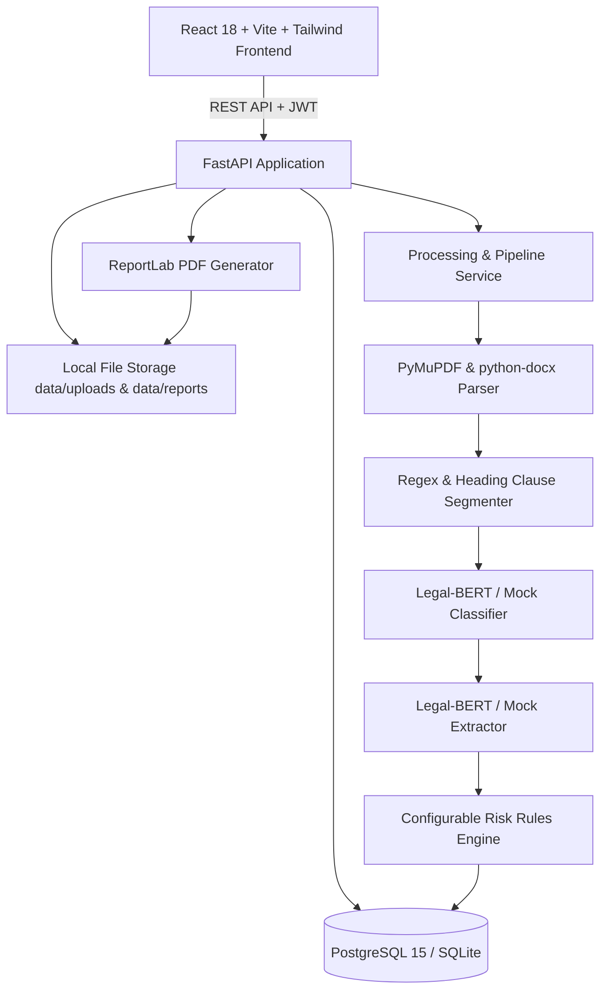

# ClauseGuard Master Implementation Plan

ClauseGuard is an AI-based Contract Clause Extraction and Risk Flagging System built strictly to specification.

---

## 1. System Architecture

---

## 2. Phased Execution Roadmap

### Phase 0: Scaffold + Docker + Configuration + Health
- [x] Inspect environment (Python 3.11, PyTorch 2.5.1 with CUDA, Node v25.7, Docker)
- [ ] Scaffold folder hierarchy: `backend/`, `frontend/`, `ml/`, `models/`, `data/`, `sample_contracts/`
- [ ] Create `.env.example` and local `.env`
- [ ] Build backend core config, logging, and health endpoint (`/api/health`)
- [ ] Build `docker-compose.yml`, `backend/Dockerfile`, `frontend/Dockerfile`
- [ ] Verify initial backend tests run with pytest

### Phase 1: Authentication + Database + Migrations + Roles
- [ ] SQLAlchemy 2.0 models: `User`, `Document`, `Clause`, `RiskFlag`, `Report`, `RiskRule`, `ClauseCorrection`, `AuditLog`
- [ ] Database session management (supports PostgreSQL and SQLite)
- [ ] Security module: password hashing (bcrypt), JWT creation and verification
- [ ] Seed script / startup event for admin user and default risk rules
- [ ] Auth endpoints: `/api/auth/register`, `/api/auth/login`, `/api/auth/me`
- [ ] Tests for auth, JWT, and role-based permissions

### Phase 2: Documents + Upload + Storage + History + Progress
- [ ] Secure upload handler: magic-byte validation, file extension, max 20MB, max 60 pages
- [ ] Document endpoints: `POST /api/documents`, `GET /api/documents`, `GET /api/documents/{id}`, `GET /api/documents/{id}/status`, `DELETE /api/documents/{id}`
- [ ] Cascade deletion logic (removes files, clauses, risk flags, reports)
- [ ] Document ownership and access isolation tests

### Phase 3: Parser + Segmenter + Classifier + Extractor + Risk Engine + Async Pipeline
- [ ] Document Parser (`backend/app/services/parser.py`): PDF (PyMuPDF) and DOCX (python-docx) with page tracking and header/footer cleanup
- [ ] Clause Segmenter (`backend/app/services/segmenter.py`): numbering detection (`1.`, `1.1`, `(a)`, `Section`, `Article`), short fragment merge (<25 words), sentence split (>400 words)
- [ ] ML Service Interface (`backend/app/services/classifier.py`, `backend/app/services/extractor.py`):
  - Mock mode: deterministic rule/keyword stubs matching exact real schema
  - Real mode: loads Legal-BERT classifier and QA extractor
- [ ] Risk Engine (`backend/app/services/risk_engine.py`):
  - YAML rule store (`backend/app/config/rules.yaml`) + DB sync
  - Rule codes: `TERM_UNILATERAL`, `TERM_NO_NOTICE`, `TERM_SHORT_NOTICE`, `TERM_FAIR`, `LIAB_UNLIMITED`, `LIAB_LOW_CAP`, `LIAB_CAP_OK`, `CONF_INDEFINITE`, `CONF_LONG_TERM`, `CONF_FAIR`, `INDEM_NEGLIGENCE`, `INDEM_BROAD`, `INDEM_MUTUAL`, `RENEW_AUTO_SHORT`, `RENEW_AUTO_LONG`, `RENEW_MANUAL`, `PAY_DISCRETION`, `PAY_VAGUE`, `PAY_CLEAR`, `DISP_ARB_FAR`, `DISP_MUTUAL`
  - Scoring: 0-29 Low, 30-59 Medium, 60-100 High; bounded 0-100; high rule forces High; confidence < 0.50 triggers `needs_review`
  - Template-based plain English explanations & suggestions (no LLM)
- [ ] Asynchronous pipeline background task: queued -> parsing -> classifying -> scoring -> done (with progress %)
- [ ] Positive and negative unit tests for all 21 risk rules and segmentation

### Phase 4: Results Dashboard + Viewer + Highlighting + PDF Report
- [ ] ReportLab PDF Report Generator (`backend/app/services/report_generator.py`)
- [ ] Report endpoints: `POST /api/documents/{id}/report`, `GET /api/reports/{id}/download`
- [ ] Modern Frontend setup (React 18 + Vite + TypeScript + Tailwind CSS + Recharts + Lucide)
- [ ] Pages:
  - Landing (`/`): hero, workflow, example cards, local privacy badge, disclaimer
  - Auth (`/login`, `/register`)
  - Document History (`/documents`)
  - Upload (`/upload`) with drag-and-drop & live progress polling
  - Results (`/documents/:id`): stats bar, risk distribution chart, filterable clause table, synchronized clause viewer with risk highlights, clause detail drawer with copy button and PDF report download
- [ ] Accessible UI design: multi-channel risk indication (color, badge, icon, text), prominent disclaimer

### Phase 5: Admin + Review Queue + Rule Editor + Audit + Stats
- [ ] Admin Review Queue (`/admin/review`): display low-confidence clauses (<0.50), category correction, note, re-run risk scoring
- [ ] Admin Rule Editor (`/admin/rules`): edit weights, patterns, severity, enabled status dynamically without code changes
- [ ] Admin Audit Logs (`/admin/audit`): record and filter login, upload, analysis, download, correction, rule update events
- [ ] Admin Stats (`/admin/stats`): aggregate metrics, document counts, avg processing time, risk breakdown
- [ ] Frontend admin views with permission guards

### Phase 6: Dataset Scripts + Real ML Training & Inference Pipeline
- [ ] `ml/scripts/prepare_ledgar.py`: inspects Hugging Face LexGLUE LEDGAR, discovers features/splits/labels, derives `label2id.json`, `id2label.json`, and semantic `taxonomy_mapping.json`
- [ ] `ml/scripts/train_classifier.py`: fine-tunes Legal-BERT sequence classification with dynamic class count, validation macro-F1 early stopping, saves to `models/classifier`
- [ ] `ml/scripts/prepare_cuad.py`: inspects CUAD dataset, extracts question mappings, converts to SQuAD 2.0 format
- [ ] `ml/scripts/train_extractor.py`: fine-tunes Legal-BERT QA model, saves to `models/extractor`
- [ ] `ml/scripts/evaluate.py`: generates evaluation metrics (accuracy, micro-F1, macro-F1, per-class F1, confusion matrix, EM, QA F1) saved in `ml/reports`
- [ ] Verification of real mode loader and fallback

### Phase 7: Security Hardening + Sample Contracts + Verification + Documentation
- [ ] Create 3 sample contracts in `sample_contracts/` (standard commercial agreement, high-risk vendor contract, balanced mutual NDA/SOW)
- [ ] Run full test suite: unit tests, API tests, security tests, rule tests, end-to-end pipeline tests
- [ ] Comprehensive README with setup, architecture, Docker instructions, ML instructions, real vs mock mode, honest performance benchmarks and limitations
